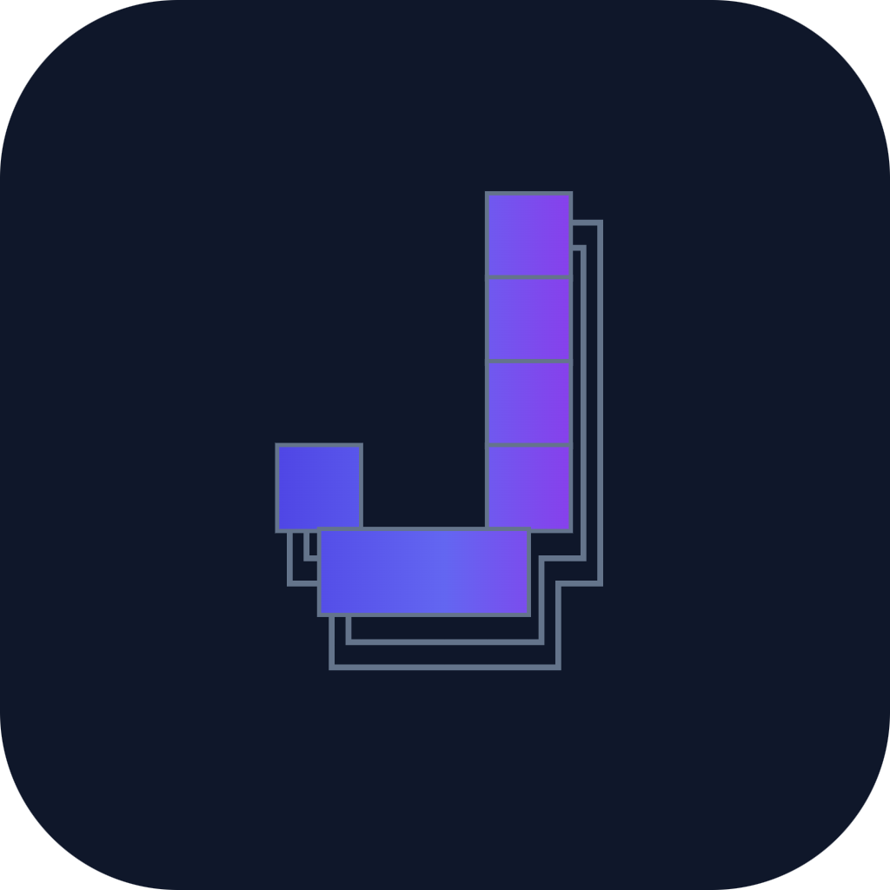

<p align="center">
  
</p>

<h1 align="center">Jesutobits</h1>

<p align="center"><strong>An AI agent that builds in front of you.</strong><br>
The desktop app: VS Code (Code-OSS) with the Jesutobits agent built in.</p>

---

This repository builds the **Jesutobits app** for Windows, Linux and macOS. It takes VS Code's open-source code, applies a short list of changes, builds in the Jesutobits extension (the agent, the live preview, visual editing and the companion, from the [`jesutobits`](https://github.com/divinefavourak/jesutobits) repository) and packages the result.

What Jesutobits does, and how the agent works, is described in the [`jesutobits` README](https://github.com/divinefavourak/jesutobits#readme). This page is about the app itself: getting it, what differs from VS Code, and how it is built.

## Download

**[Download the latest release](https://github.com/divinefavourak/jesutobits-ide/releases/latest)** and pick the file for your computer:

| Your computer | File | Install |
|---|---|---|
| Windows 10/11 (x64) | `JesutobitsSetup-<version>-windows-x64.exe` | Run it. It installs for your user, no admin needed |
| Ubuntu, Debian | `jesutobits-<version>-linux-x64.deb` | `sudo apt install ./jesutobits-<version>-linux-x64.deb` |
| Fedora, openSUSE | `jesutobits-<version>-linux-x64.rpm` | `sudo dnf install ./jesutobits-<version>-linux-x64.rpm` |
| Any Linux (x64) | `jesutobits-<version>-linux-x64.tar.gz` | Unpack it and run `Jesutobits-linux-x64/jesutobits` |
| Mac with Apple Silicon (M1 and later) | `Jesutobits-<version>-macos-arm64.dmg` (or `.zip`) | Open the disk image and drag Jesutobits to Applications |
| Mac with Intel | `Jesutobits-<version>-macos-x64.dmg` (or `.zip`) | The same |

Each release also has `SHA256SUMS.txt`, to check a download. Every [release](https://github.com/divinefavourak/jesutobits-ide/releases) lists what changed.

**Newer than the latest release:** every push to `main` builds all platforms too. Those builds are under [Actions](https://github.com/divinefavourak/jesutobits-ide/actions) (sign in to GitHub to download; each package is its own `.zip`, kept for 14 days).

### The first open

The app is not signed with a paid certificate yet, so each system may warn once:

- **Windows:** SmartScreen may say "Windows protected your PC". Choose **More info**, then **Run anyway**.
- **macOS:** the app is signed ad hoc, not with an Apple Developer ID, so macOS cannot check it. Open **System Settings > Privacy & Security** and choose **Open Anyway** for Jesutobits (or run `xattr -dr com.apple.quarantine /Applications/Jesutobits.app`).
- **Linux:** no warning. Saved keys use your desktop's keyring (GNOME Keyring or KWallet). Under WSL, install the Windows app instead.

### How well each platform is tested

| Platform | Built by CI | Tried by hand |
|---|---|---|
| Windows x64 | Yes | Yes: installed and used (welcome, account, sign-in, previews) |
| Linux x64 | Yes | Yes: the `.deb` installed and started under WSL (Ubuntu 26.04) |
| macOS Apple Silicon and Intel | Yes | Not yet: no Mac to try it on |

## What is different from VS Code

Jesutobits is a separate app with its own identity, so it installs next to VS Code without sharing anything.

**Its own identity**

- Name, data folders (`~/.jesutobits`), app IDs (`dev.jesutobits.app` on macOS, `dev.jesutobits.Jesutobits` on Linux, its own Windows IDs) and URL protocol (`jesutobits://`).
- The "J" icon everywhere: the app, the installer, the Dock and the disk image, the title bar and the empty-editor watermark.

**The Jesutobits experience** (each change is listed in [`PATCHES.md`](PATCHES.md))

- A two-column welcome popup: a little hello, a theme, connecting OpenRouter (with **Sign in with OpenRouter** and an optional free model) and a first idea.
- The Studio layout: the agent on the right, the preview in the middle with a greeting above it, and Get Started, New Project and Themes in the top bar.
- Your avatar in the top-right corner, opening **Your account**: profile, OpenRouter connection and credits, model and privacy, and how much the agent checks with you.

**Without Microsoft's services**

- Extensions come from [Open VSX](https://open-vsx.org). The Visual Studio Marketplace, and Microsoft's own extensions that are licensed only for VS Code (such as Remote Development, Live Share and C# Dev Kit), are not available to forks.
- No telemetry endpoint, no update service (install a newer build to update), no Microsoft voice service.
- No Copilot extension (it cannot be built outside Microsoft). Copilot's chat and GitHub sign-in prompts are hidden by default (`chat.disableAIFeatures`); Jesutobits brings its own agent.
- No `jesutobits tunnel` command: VS Code's remote-tunnel CLI is built separately by Microsoft and is not included.

## How this repository works

It holds only the differences from upstream VS Code, in the style of [VSCodium](https://github.com/VSCodium/vscodium):

| File | What it is |
|---|---|
| `upstream.json` | The VS Code release this build follows (currently 1.143.1) and its commit |
| `product.overrides.json` | Jesutobits' identity, Open VSX as the extension gallery, Microsoft-only keys removed |
| `patches/*.patch` | Changes to VS Code's source, each explained in [`PATCHES.md`](PATCHES.md) |
| `branding/` | The icons and logo files, at the paths they replace in the source (generated by `scripts/gen-app-icons.mjs` in the `jesutobits` repository) |
| `scripts/prepare.mjs` | Downloads the upstream source, applies the patches and branding, merges `product.json`, optionally adds the Jesutobits extension |
| `scripts/build.mjs` | Installs dependencies and runs the gulp tasks that build one platform's app and packages |
| `.github/workflows/build.yml` | CI: the four platforms in parallel |

The Jesutobits logic (agent runtime, extension, panels) lives in the `jesutobits` repository; this one never contains it. Updating to a new VS Code release is described in [`UPSTREAM.md`](UPSTREAM.md).

## Build it yourself

**Prerequisites on every platform:** the Node version in VS Code's `.nvmrc` (24.18.0 for 1.143.1), Python 3, Git, and about 16 GB of RAM and 15 GB of free disk. The npm registry and GitHub must be reachable. Then:

- **Windows x64:** Visual Studio Build Tools with "Desktop development with C++" and the **MSVC Spectre-mitigated libraries**.
- **Linux x64:** `pkg-config libgtk-3-0 libxkbfile-dev libkrb5-dev libgbm1 rpm fakeroot dpkg` (Debian/Ubuntu names). Native modules are built against VS Code's glibc 2.28 sysroot, which the build downloads, so the app runs on the same distributions as VS Code.
- **macOS (Apple Silicon or Intel):** Xcode's command line tools. Build each architecture on a Mac of that architecture.

To build the agent in, first build the extension in the `jesutobits` repository: `pnpm install && pnpm build:packages && pnpm build:extension`. Then, here:

```bash
node scripts/prepare.mjs                                          # Code-OSS rebranded as Jesutobits
node scripts/prepare.mjs --extension ../jesutobits/apps/vscode-extension   # ... with the agent built in
node scripts/build.mjs                                            # this machine's platform, into dist/
node scripts/build.mjs --target linux-x64                         # or name the target
```

`prepare.mjs --clean` starts again from a fresh download. `build.mjs --skip-install` reuses an earlier `npm ci`; `--no-installer` stops after the app folder (`VSCode-<target>/`).

| Target | Packages in `dist/` |
|---|---|
| `win32-x64` | `JesutobitsSetup-<version>-windows-x64.exe` (per-user installer) |
| `linux-x64` | `jesutobits-<version>-linux-x64.deb`, `.rpm` and `.tar.gz` |
| `darwin-arm64`, `darwin-x64` | `Jesutobits-<version>-macos-<arch>.dmg` and `.zip` |

`<version>` is the Jesutobits extension's version when it is built in (0.3.0), else VS Code's tag.

Each target follows the steps of VS Code's own release pipelines (`vscode/build/azure-pipelines`). Mac apps are signed ad hoc, which Apple Silicon needs to run them at all; with an Apple Developer ID, signing and notarising would follow VS Code's `build/azure-pipelines/darwin/codesign.ts`.

### CI

[`.github/workflows/build.yml`](.github/workflows/build.yml) runs on every push to `main` (and by hand from the Actions tab). It builds the Jesutobits extension from the `jesutobits` repository (the `pivot/code-oss` branch until it is merged; choose another ref when running it by hand), then the app with it built in, on four runners at once:

| Job | Runner | Artifacts |
|---|---|---|
| Windows x64 | `windows-latest` | `jesutobits-windows-x64-setup` |
| Linux x64 | `ubuntu-latest` | `jesutobits-linux-x64-deb`, `-rpm`, `-tar` |
| macOS Apple Silicon | `macos-latest` | `jesutobits-darwin-arm64-dmg`, `-zip` |
| macOS Intel | `macos-15-intel` | `jesutobits-darwin-x64-dmg`, `-zip` |

One platform failing does not stop the others. A build usually takes 15 to 30 minutes, longer when GitHub's runners are busy.

### Releasing

1. In the `jesutobits` repository, set the version (`apps/vscode-extension/package.json`, `packages/runtime/src/version.ts`), add its `CHANGELOG.md` entry, and push a tag `v<version>`.
2. Here, write `release-notes/v<version>.md` (the text of the release page) and push the same tag `v<version>`.

The tag builds all four platforms from the `jesutobits` tag of the same name; when every build passes, a release job publishes them, with `SHA256SUMS.txt`, as the GitHub release `Jesutobits <version>`.

## License

Code-OSS is MIT-licensed by Microsoft (`LICENSE.txt` in every build). "Visual Studio Code" and its logo are Microsoft trademarks and are not used here.
